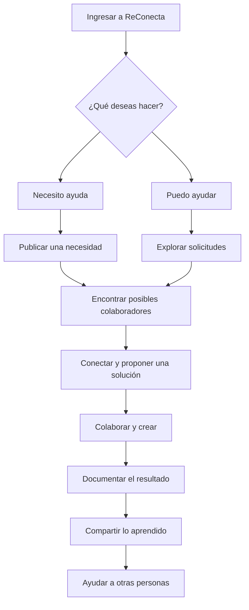

# Reto de clase #2: Círculo Generador Maker

**Estudiante:** Paula Castillo  
**Proyecto:** ReConecta – Banco de Soluciones Comunitarias  
**Curso:** Activadores de Comunidades de Práctica  
**Modalidad:** Propuesta individual  
**País:** Panamá  

---

## 1. Nombre del proyecto

### ReConecta: Pequeñas acciones, grandes conexiones

ReConecta es una propuesta de plataforma digital comunitaria que busca conectar a personas que necesitan ayuda para resolver problemas cotidianos con otras que tienen conocimientos, habilidades o recursos para apoyarlas.

La idea es demostrar que todas las personas tienen algo que aportar y que, a través de la colaboración, podemos crear soluciones y aprender unas de otras.

---

## 2. Situación e intención

### Situación identificada

Muchas veces las personas enfrentan dificultades que podrían resolverse con la ayuda de alguien de su comunidad, pero no saben a quién acudir.

Por ejemplo, una persona mayor puede necesitar ayuda para utilizar una aplicación, un estudiante puede tener dificultades con su computadora o una emprendedora puede querer crear herramientas digitales para su negocio.

Al mismo tiempo, existen personas con conocimientos y habilidades que estarían dispuestas a ayudar, pero no cuentan con un espacio que facilite esa conexión.

### Intención

**Queremos crear una plataforma comunitaria que conecte necesidades con habilidades, para que las personas puedan colaborar, compartir conocimientos y encontrar soluciones a problemas reales.**

Buscamos que las personas no solamente reciban ayuda, sino que también puedan aprender y, en el futuro, ayudar a otras.

---

## 3. Dominio

La comunidad se enfoca en:

- Tecnología e innovación social.
- Cultura maker y resolución de problemas.
- Aprendizaje colaborativo.
- Intercambio de conocimientos y habilidades.
- Participación comunitaria.
- Creación de soluciones accesibles.

El objetivo es utilizar la tecnología como una herramienta para facilitar la colaboración y fortalecer las relaciones entre las personas.

---

## 4. Comunidad

### Participantes

| Participantes | Capacidades que podrían aportar |
| --- | --- |
| Estudiantes | Conocimientos tecnológicos, creatividad e ideas nuevas. |
| Profesionales | Experiencia y orientación en diferentes áreas. |
| Emprendedores | Problemas reales, experiencias y oportunidades de colaboración. |
| Vecinos | Conocimiento de las necesidades de su comunidad. |
| Voluntarios | Tiempo, habilidades y acompañamiento. |
| Mentores | Orientación y apoyo para desarrollar soluciones. |

### ¿Cómo puede integrarse una persona nueva?

1. Ingresar a ReConecta.
2. Explorar las necesidades publicadas.
3. Identificar un problema que le interese.
4. Publicar una necesidad o seleccionar una oportunidad para ayudar.
5. Participar en la búsqueda de una solución.
6. Compartir lo aprendido con la comunidad.

La participación estaría abierta a personas con diferentes niveles de experiencia.

---

## 5. Práctica compartida

La práctica principal de ReConecta consiste en identificar problemas cotidianos, proponer soluciones y colaborar para llevarlas a cabo.

### Actividades propuestas

- **Retos comunitarios:** Publicar necesidades que puedan resolverse mediante colaboración.
- **Intercambio de habilidades:** Compartir conocimientos tecnológicos, creativos y prácticos.
- **Sesiones colaborativas:** Organizar encuentros virtuales o presenciales para trabajar en soluciones.
- **Proyectos maker:** Crear prototipos sencillos utilizando materiales disponibles o herramientas digitales.
- **Documentación:** Registrar las soluciones para que otras personas puedan aprender de ellas.
- **Mentorías:** Permitir que participantes con experiencia acompañen a quienes están comenzando.

### Recursos

- Plataforma web.
- Computadoras o dispositivos móviles.
- Herramientas digitales gratuitas.
- Materiales reutilizables.
- Documentos colaborativos.
- Repositorio de proyectos y soluciones.

---

## 6. Trayectorias de participación

ReConecta busca que las personas puedan integrarse progresivamente a la comunidad.

| Etapa | Acción |
| --- | --- |
| **Observar** | Explorar las necesidades y soluciones publicadas por otras personas. |
| **Preguntar** | Consultar sobre un problema o solicitar orientación. |
| **Contribuir** | Ofrecer conocimientos, habilidades o ideas para resolver una necesidad. |
| **Acompañar** | Ayudar a otros participantes y compartir experiencias. |

### Niveles de participación

**Nivel 1: Explorador**

Conoce la plataforma e identifica necesidades de la comunidad.

**Nivel 2: Participante**

Publica una necesidad, realiza preguntas o comparte ideas.

**Nivel 3: Colaborador**

Participa activamente en la solución de problemas.

**Nivel 4: Mentor**

Comparte conocimientos y acompaña a nuevos integrantes.

La intención es que las personas puedan pasar de recibir ayuda a convertirse en quienes ayudan a otros.

---

## 7. Representación de la propuesta

### Funcionamiento de ReConecta

### Ejemplo práctico

Una emprendedora necesita crear un formulario digital para recibir pedidos de sus clientes.

1. Ingresa a ReConecta.
2. Publica su necesidad.
3. Un estudiante con conocimientos de programación encuentra la solicitud.
4. El estudiante ofrece su ayuda.
5. Ambos colaboran para crear un formulario sencillo.
6. Prueban si el formulario permite registrar pedidos correctamente.
7. Documentan los pasos utilizados.
8. Comparten la solución para que otras personas puedan aprender.

Este ejemplo muestra cómo una necesidad cotidiana puede convertirse en una oportunidad de aprendizaje y colaboración.

---

## 8. Prototipo y función

### Prototipo propuesto

Se propone desarrollar una primera versión sencilla de una página web interactiva.

La página incluiría tres funciones principales:

**1. Publicar una necesidad**

La persona escribe un título, describe su problema y selecciona una categoría.

**2. Explorar necesidades**

Las solicitudes aparecen organizadas en tarjetas que permiten identificar qué tipo de ayuda se necesita.

**3. Ofrecer ayuda**

Una persona selecciona una solicitud y puede indicar que desea colaborar.

### Función principal

Permitir que una persona publique una necesidad y que otra pueda encontrarla y expresar su interés en ayudar.

### Criterio de funcionamiento

Sabremos que el prototipo cumple su función si una persona puede publicar una solicitud y otra puede encontrarla e indicar que desea colaborar, sin necesitar instrucciones adicionales.

### Tecnologías propuestas

- HTML para la estructura.
- CSS para el diseño.
- JavaScript para la interacción.
- Almacenamiento local para simular las publicaciones durante la primera prueba.

En esta versión no sería necesario crear cuentas reales ni almacenar información personal.

### Estado actual

| Elemento | Estado |
| --- | --- |
| Nombre del proyecto | Definido |
| Problema e intención | Definidos |
| Comunidad objetivo | Identificada |
| Funciones principales | Propuestas |
| Diagrama de funcionamiento | Documentado |
| Página web funcional | Pendiente de desarrollar |
| Pruebas con usuarios | Pendientes |

---

## 9. Prueba y aprendizaje

### Objetivo

Comprobar si las personas comprenden el funcionamiento de ReConecta y pueden utilizar las funciones principales del prototipo.

### Procedimiento propuesto

1. Desarrollar una versión básica de la página web.
2. Invitar de 3 a 5 personas a probarla.
3. Pedir a una persona que publique una necesidad ficticia.
4. Solicitar a otra persona que encuentre esa publicación.
5. Pedirle que seleccione la opción para ofrecer ayuda.
6. Observar si pueden completar las acciones sin orientación.
7. Registrar dificultades y comentarios.
8. Identificar mejoras para una siguiente versión.

### Indicadores

| Indicador | Qué se observará |
| --- | --- |
| Navegación | Si las personas encuentran fácilmente las funciones. |
| Publicación | Si pueden registrar una necesidad. |
| Búsqueda | Si encuentran una solicitud publicada. |
| Interacción | Si pueden seleccionar la opción para colaborar. |
| Comprensión | Si entienden el propósito de la plataforma. |
| Motivación | Si estarían interesadas en participar en una comunidad similar. |

### Resultados y aprendizajes

**Qué esperamos:** Que la mayoría de los participantes comprenda el propósito de la plataforma y pueda completar las acciones básicas sin ayuda.

**Qué hemos realizado:** Se ha definido la propuesta, la función principal y el procedimiento de prueba.

**Qué ocurrió:** Todavía no se ha ejecutado la prueba con usuarios.

**Qué cambiaríamos:** Se decidirá después de observar las dificultades y recopilar comentarios.

### Supuestos por verificar

- Las personas estarían dispuestas a compartir sus conocimientos.
- Una plataforma sencilla facilitaría la colaboración.
- Las personas podrían encontrar necesidades relacionadas con sus habilidades.
- Compartir soluciones podría motivar a otros a participar.

Estos supuestos deberán comprobarse mediante pruebas reales.

---

## 10. Continuidad

La intención es que ReConecta pueda crecer progresivamente y convertirse en una comunidad activa.

### Acciones futuras

- Incorporar nuevas categorías de necesidades.
- Organizar retos comunitarios periódicos.
- Crear una biblioteca de soluciones.
- Desarrollar espacios de mentoría.
- Permitir que las personas compartan proyectos terminados.
- Establecer alianzas con instituciones educativas y organizaciones comunitarias.

### Próxima acción

Construir una primera versión navegable de la página web y realizar una prueba con 3 a 5 participantes.

**Responsable:** Paula Castillo.

**Fecha de prueba:** Por definir.

### ¿Cómo podría continuar otra persona?

Cada solución podría documentarse indicando:

1. Problema identificado.
2. Materiales o herramientas utilizados.
3. Procedimiento.
4. Resultado de la prueba.
5. Dificultades encontradas.
6. Posibles mejoras.

De esta manera, otras personas podrían reproducir, adaptar o mejorar las soluciones.

---

## 11. Uso de inteligencia artificial

### Herramienta de apoyo

ChatGPT.

### ¿En qué ayudó la IA?

La inteligencia artificial se utilizó como apoyo para:

- Organizar la propuesta del proyecto.
- Estructurar el Mapa de Comunidad.
- Identificar posibles participantes.
- Proponer trayectorias de participación.
- Representar el funcionamiento de la plataforma.
- Definir una prueba inicial.
- Identificar supuestos y tareas pendientes.

### Decisiones de la propuesta

Se seleccionó el concepto de ReConecta como una plataforma para conectar necesidades comunitarias con personas que puedan aportar soluciones.

La propuesta se centra en la colaboración, el aprendizaje compartido y la posibilidad de transformar problemas cotidianos en oportunidades para crear.

El contenido generado con apoyo de IA deberá revisarse y adaptarse durante el desarrollo del prototipo y las pruebas.

---

## 12. Resultados observados y tareas pendientes

### Resultados observados

Todavía no se han realizado pruebas con usuarios ni se han registrado resultados de funcionamiento.

### Tareas pendientes

- [x] Definir el nombre del proyecto.
- [x] Identificar la situación y la intención.
- [x] Definir la comunidad objetivo.
- [x] Establecer las funciones principales.
- [x] Documentar el flujo de funcionamiento.
- [x] Diseñar el procedimiento de prueba.
- [ ] Crear un boceto visual de la interfaz.
- [ ] Desarrollar el prototipo web.
- [ ] Realizar pruebas con 3 a 5 personas.
- [ ] Registrar los resultados.
- [ ] Incorporar mejoras.
- [ ] Definir la fecha de la siguiente prueba.

---

## 13. Conclusión

ReConecta nace de una idea sencilla: muchas veces la solución a un problema puede estar en los conocimientos de otra persona.

A través de una plataforma comunitaria, buscamos facilitar conexiones entre personas que necesitan ayuda y otras que pueden ofrecerla.

Más allá de resolver problemas, el proyecto busca crear oportunidades para aprender, colaborar y compartir experiencias.

Esta primera propuesta representa el punto de partida para desarrollar un prototipo, comprobar su utilidad y explorar cómo podría crecer una comunidad de práctica alrededor de la colaboración.

**Porque todos tenemos algo que aprender y algo que enseñar.**

---

**Proyecto:** ReConecta  
**Documento:** `mapa-comunidad.md`  
**Autora:** Paula Castillo  
**Versión:** 1.0 – Propuesta inicial  
**País:** Panamá
